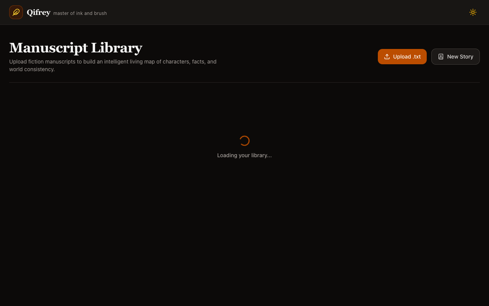
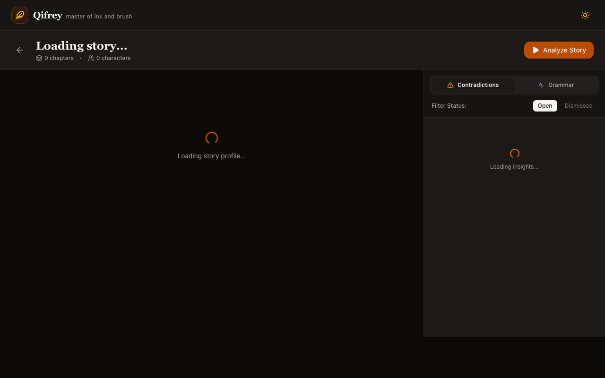
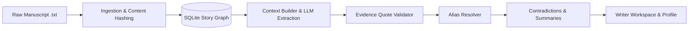

# Qifrey — Master of Ink and Brush

> **Drop your manuscript in. Get a living map of every character, fact, and contradiction in your story.**

Authors of long fiction frequently lose track of their own worlds: who has which eye color, what happened under which alias, and whether a timeline detail contradicts an earlier chapter. Qifrey reads your manuscript chapter-by-chapter and constructs an incremental, queryable story graph so you never lose consistency.

---

## Screenshots

| Library Catalog | Story Profile & Contradictions |
| :---: | :---: |
|  |  |

---

## Features

- **Ingestion & Auto-Chunking:** Ingests raw `.txt` manuscripts, cleans Project Gutenberg boilerplate, auto-detects chapter headings ("Chapter 1", "CHAPTER IV", Roman numerals), and hashes chapters with SHA-256 for incremental processing.
- **Graph-First Memory:** Extracts canonical characters, aliases, locations, and relationships. Every fact is verified against verbatim source quotes before entering the graph.
- **Contradiction Adjudicator:** Identifies conflicting physical attributes and backstory facts across chapters, sending candidates to an LLM adjudicator that distinguishes genuine plot errors from legitimate character progression (haircuts, aging, moving house).
- **Author Control & Human Agency:** Dismiss issues or mark them as intentional; Qifrey remembers your decisions and will never flag the same fact pair again.
- **Fiction-Friendly Grammar:** Integrated LanguageTool engine preconfigured for creative fiction (disables strict style rules and skips colloquialisms/fragments within dialogue quotes).
- **Write Mode Editor:** Chapter-by-chapter authoring environment powered by CodeMirror 6 with 1.5-second debounce auto-save, live grammar annotations with click-to-apply replacements, and drag-and-drop chapter reordering.
- **Incremental Analysis:** Modifying one chapter re-analyzes only that chapter and removes its stale facts, leaving the rest of the manuscript untouched.
- **Evaluation Harness:** Offline and online evaluation benchmarks comparing extraction accuracy against human-annotated gold standards, naive NER baselines, and synthetic contradiction injection.

---

## Architecture Overview



For full pipeline diagrams and module breakdowns, see [docs/architecture.md](docs/architecture.md).  
For architectural choices and trade-offs, see [docs/decisions.md](docs/decisions.md).

---

## Setup & Prerequisites

### Prerequisites
- **Python:** 3.11+
- **Node.js:** 20+ and npm
- **Java:** JRE 11+ (optional, required if running local LanguageTool grammar server; degrades gracefully if absent)

### Environment Variables
Copy `.env.example` in `backend/` or set the following in your environment:

```bash
# LLM Provider & Credentials
QIFREY_LLM_PROVIDER=gemini        # 'gemini' | 'anthropic' | 'fake'
QIFREY_LLM_MODEL=gemini-2.5-flash # or 'claude-sonnet-4-20250514'
QIFREY_LLM_FALLBACK_MODEL=gemini-1.5-flash # optional fallback if primary returns 503
QIFREY_LLM_MAX_RPM=10             # Rate limit throttle: max requests per minute

# Provider API Keys (set the key for your provider)
GEMINI_API_KEY=your_gemini_api_key_here
ANTHROPIC_API_KEY=your_anthropic_api_key_here

# Database & Upload Settings
QIFREY_DB_PATH=qifrey.db          # Path to SQLite file or ':memory:'
QIFREY_MAX_UPLOAD_BYTES=5242880   # 5 MB max upload
```

---

## How to Run

### Option A: Local Development

1. **Backend Server:**
   ```bash
   cd backend
   python -m venv .venv
   source .venv/bin/activate
   pip install -e ".[dev]"
   cp .env.example .env
   uvicorn qifrey.main:app --reload --port 8000
   ```

2. **Frontend UI:**
   ```bash
   cd frontend
   npm install
   npm run dev
   # Open http://localhost:5173
   ```

### Option B: Docker Compose (Optional)

```bash
docker compose up --build
# Backend available at http://localhost:8000
# Frontend available at http://localhost:5173
```

---

## How to Run Tests

Qifrey maintains complete test coverage across every module with mocked LLM calls:

```bash
# Backend pytest suite (77+ tests)
cd backend
.venv/bin/pytest

# Backend linting & format check
.venv/bin/ruff check .
.venv/bin/ruff format --check .

# Frontend linting & build verification
cd ../frontend
npm run lint
npm run build
```

---

## How to Evaluate

Run the evaluation benchmark against the hand-labeled gold standard:

```bash
cd backend

# Run evaluation on gold standard stories (outputs reports to eval/reports/)
python -m eval.run_eval --gold eval/gold --out eval/reports

# Run evaluation offline with FakeLLMClient
python -m eval.run_eval --gold eval/gold --out eval/reports --fake

# Programmatically inject contradictions & legitimate changes to test detector accuracy
python -m eval.inject_contradictions \
  --input eval/gold/example_story.json \
  --out eval/gold/injected.json \
  --key eval/gold/injected_key.json \
  --n 1
```

---

## Privacy & Manuscript Security

- **100% Local Storage:** Manuscripts, chapter text, character details, and story graphs are stored locally on your machine in an SQLite database file.
- **No Model Training:** When using Anthropic API keys, prompts are sent strictly for stateless inference; your manuscripts are never used for model training or retained in public training corpora.
- **Air-Gapped Friendly:** When run with local offline LLMs or the mock engine, zero outbound network traffic is generated.
- **Safe Secrets Handling:** API keys and credentials are read exclusively through environment variables and never logged or persisted into the database.

---

## Roadmap

- [ ] **Knowledge-State Tracking:** Track which characters know which secrets at each point in the timeline.
- [ ] **Plot Thread & Subplot Tracking:** Track open narrative questions and unfinished promises across chapter arcs.
- [ ] **Timeline Reconstruction:** Chronological sequence mapping for non-linear stories and flashbacks.
- [ ] **Live Writing Assistant:** Real-time character profile card popovers as you write in the editor.
- [ ] **Graph Database Connector:** Optional Neo4j / Memgraph adapter for complex social network visualizations.
- [ ] **Local LLM Integration:** First-class support for Ollama and `llama.cpp` for 100% offline, air-gapped authoring.

---

## License

This project is licensed under the [MIT License](LICENSE). Public domain sample texts are sourced from [Project Gutenberg](https://www.gutenberg.org/) (see [data/samples/README.md](data/samples/README.md)).
