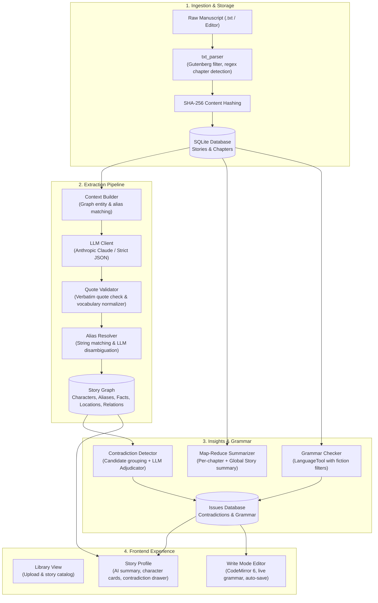

# Qifrey Architecture Overview

Qifrey ("master of ink and brush") turns long fiction manuscripts into a living, queryable story graph of characters, facts, and inconsistencies.

## Pipeline Architecture

## Module Directory Structure

| Module Path | Layer | Responsibility | Key Interfaces |
| :--- | :--- | :--- | :--- |
| `backend/src/qifrey/api/` | API | FastAPI routers and Pydantic v2 request/response schemas. | `GET/POST /api/stories`, `PUT/DELETE /api/chapters`, `/api/health` |
| `backend/src/qifrey/db/` | Data | SQLAlchemy 2.0 ORM models, session factories, and connection pooling. | `Base`, `Story`, `Chapter`, `Character`, `Fact`, `Issue`, `LLMCall` |
| `backend/src/qifrey/ingestion/` | Ingestion | Raw text decoding, Gutenberg header/footer stripping, and chapter regex splitting. | `decode_upload()`, `parse_chapters()` |
| `backend/src/qifrey/pipeline/` | Pipeline | Context builder, LLM client interfaces, quote validation, and pipeline runner. | `LLMClient`, `complete_json()`, `validate_extraction()`, `analyze_story()` |
| `backend/src/qifrey/graph/` | Graph | Alias resolution and transactional graph storage for characters, facts, and relations. | `resolve_or_create_character()`, `upsert_character()`, `delete_chapter_data()` |
| `backend/src/qifrey/insights/` | Insights | Grouping facts by attribute, LLM contradiction adjudication, and map-reduce summaries. | `detect_contradictions()`, `adjudicate_contradiction()`, `generate_summaries()` |
| `backend/src/qifrey/grammar/` | Grammar | LanguageTool wrapper with fiction-friendly disabled rules and dialogue skip logic. | `check_grammar()` |
| `backend/eval/` | Evaluation | Offline/online evaluation harness, alias-aware metrics, naive NER baselines, and error injector. | `run_eval.py`, `metrics.py`, `baseline.py`, `inject_contradictions.py` |
| `frontend/src/` | Frontend | React 19 + TypeScript + Vite + Tailwind CSS + CodeMirror 6 UI. | `<Library />`, `<StoryProfile />`, `<Editor />`, `<CharacterDrawer />` |
